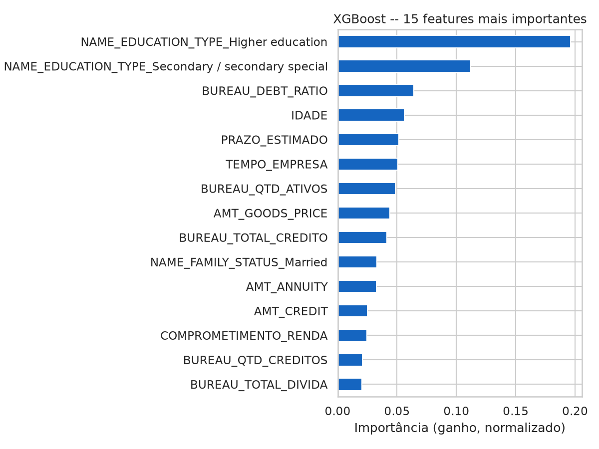

# Credix — Score de Risco de Inadimplência

[](https://github.com/anascunha/projeto_fia_credix/actions/workflows/testes.yml)

Projeto em grupo do MBA em Big Data da FIA: um serviço de Machine Learning que estima o
risco de inadimplência de uma solicitação de crédito e o expõe por uma API REST.

## Resumo

**Problema.** Empresas que concedem crédito (fintechs, varejistas, cooperativas) precisam
avaliar o risco de inadimplência de cada solicitação, mas construir e manter um modelo
próprio é caro.

**Solução.** Um pipeline de ponta a ponta sobre a base pública
[Home Credit Default Risk](https://www.kaggle.com/competitions/home-credit-default-risk):
engenharia de atributos (dados cadastrais + histórico de bureau), modelo **XGBoost**,
orquestração com **Apache Airflow**, API **FastAPI** com regras de negócio e
infraestrutura em **Docker Compose**.

**Resultados** (conjunto de teste com 61.503 clientes, 8,07% de inadimplentes):

| ROC AUC | Recall | Precision | F1 |
|---:|---:|---:|---:|
| 0,71 | 0,66 | 0,14 | 0,23 |

O modelo identifica 2 em cada 3 inadimplentes no limiar padrão. Na faixa de risco alto
(20% dos clientes), a inadimplência é de 18,4%, contra 3,8% na faixa baixa. Os números estão na
[seção 8](#8-métricas-do-modelo).

**Como rodar** (depois de aceitar as regras da competição no Kaggle e autenticar com
`kaggle auth login`):

```bash
pip install -r requirements.txt
python DataPipeline/00_baixar_dados.py    # baixa os CSVs do Kaggle
python pipeline_orchestration.py          # features -> ABT -> treino
uvicorn app.main:app --port 8000          # API em http://localhost:8000/docs
```

Os testes rodam sem os dados do Kaggle: `pytest`. Passo a passo completo, incluindo
Docker e Airflow, em [COMO_RODAR.md](COMO_RODAR.md).

### O que está implementado e o que é proposta

| Item | Status |
|---|---|
| Pipeline de dados (features, bureau, ABT) | ✅ Implementado |
| Treino e avaliação do XGBoost, comparação com 3 algoritmos | ✅ Implementado |
| Importância das features | ✅ Implementado (`metrics/importancia_features.csv` e notebook) |
| API FastAPI (`/predict`, `/health`) com regras de negócio | ✅ Implementado |
| Registro das previsões (SQLite) e consulta do histórico pela API | ✅ Implementado ([seção 14.1](#141-registro-das-previsões-implementado)) |
| DAG do Airflow (uma tarefa por etapa) | ✅ Implementado |
| Docker Compose (API + Airflow) | ✅ Implementado |
| Testes automatizados (pytest) e CI no GitHub Actions | ✅ Implementado |
| Monitoramento de performance com os resultados registrados | 📝 Proposta ([seção 14.2](#142-monitoramento-proposta)) |
| Monitoramento de Data Drift e retreino automático | 📝 Proposta ([seção 15](#15-estratégia-de-retreinamento-proposta)) |
| SHAP, ações automatizadas e agentes de IA | 📝 Proposta ([seção 16](#16-plano-de-ações-automatizadas-proposta)) |

---

## 1. Visão Geral

A **Credix** é uma solução de Machine Learning criada para democratizar e reduzir o custo
de acesso a modelos preditivos aplicados à concessão de crédito.

Por meio de uma API, empresas podem obter um score de risco de inadimplência e informações
para apoiar suas decisões de crédito, sem precisar investir na construção, implantação e
manutenção de um modelo próprio. A proposta é funcionar como **Machine Learning as a
Service**.

O projeto cobre as principais etapas do ciclo de vida de Machine Learning:

- preparação e tratamento dos dados;
- engenharia de atributos;
- construção da ABT (Analytical Base Table);
- treinamento e avaliação do modelo;
- persistência do modelo treinado;
- orquestração do pipeline com Apache Airflow;
- disponibilização do modelo por uma API REST em FastAPI;
- conteinerização com Docker Compose;
- testes automatizados e integração contínua;
- propostas de monitoramento, retreino e automações com agentes de IA.

---

## 2. Objetivo e saída da API

O objetivo do Credix é ordenar solicitações de crédito por risco de inadimplência e
classificá-las em faixas de risco.

A API recebe dados cadastrais e financeiros e retorna:

| Campo | Descrição |
|---|---|
| `id_solicitacao` | Identificador da previsão no registro ([seção 14.1](#141-registro-das-previsões-implementado)) |
| `score_risco` | Score do modelo, de 0 a 1. Quanto maior, maior o risco. |
| `nivel_risco` | `baixo`, `medio` ou `alto` |
| `regra_aplicada` | Regra de negócio que decidiu o risco sem consultar o modelo, se houver |

### Score, não probabilidade

O XGBoost é treinado com `scale_pos_weight=12` para compensar o desbalanceamento das classes
(ver [seção 7](#7-treinamento-do-modelo)). Esse peso aumenta artificialmente a saída do
`predict_proba`. No teste, o score médio é **0,45**, enquanto só **8,07%** dos clientes são
inadimplentes, e cerca de 38% dos clientes recebem score ≥ 0,5 (recall 0,6622 × 8,07% /
precision 0,1416). Por isso o valor
**não é tratado como probabilidade** de inadimplência, e sim como um score que ordena os
clientes.

### Faixas de risco definidas no conjunto de teste

Os cortes das faixas são calculados pelo `Model/train.py` a partir da distribuição do score
no conjunto de teste e salvos em `models/faixas_risco.json`:

| Faixa | Clientes de teste na faixa | Inadimplência observada | Parcela dos inadimplentes |
|---|---|---:|---:|
| Baixo | 50% com menor score (30.751) | 3,8% | 23,5% |
| Médio | 30% seguintes (18.451) | 8,3% | 31,0% |
| Alto | 20% com maior score (12.301) | **18,4%** | **45,5%** |

A inadimplência cresce de forma consistente entre as faixas: a faixa alta tem **4,8 vezes** a
inadimplência da baixa e, com apenas 20% dos clientes, concentra quase metade dos
inadimplentes do teste. A taxa observada em cada faixa, registrada pelo treino em
`metrics/train_metrics.json`, é a leitura correta de "chance de inadimplência" de um cliente
da faixa. As proporções ficam em `credix/regras.py` (`QUANTIS_FAIXAS`) e podem ser
ajustadas à política de crédito de cada cliente da Credix sem retreinar o modelo.

### Regras de negócio

Antes de consultar o modelo, a API aplica regras para situações extremas:

| Condição | Resultado |
|---|---|
| Renda mensal igual a zero | risco `alto` (`renda_nao_positiva`) |
| Parcela mensal maior ou igual à renda mensal (comprometimento ≥ 100%) | risco `alto` (`parcela_maior_ou_igual_renda`) |

---

## 3. Fonte dos Dados

Base da competição **Home Credit Default Risk** do Kaggle
([`home-credit-default-risk`](https://www.kaggle.com/competitions/home-credit-default-risk)),
baixada por `DataPipeline/00_baixar_dados.py`:

| Arquivo | Descrição |
|---|---|
| `application_train.csv` | Dados cadastrais, financeiros e da solicitação (307.511 clientes) |
| `bureau.csv` | Histórico de créditos dos clientes em outras instituições (1.716.428 registros) |

A variável alvo é `TARGET`: `0` para cliente adimplente e `1` para inadimplente. A base é
desbalanceada: **8,07%** de inadimplentes (`DataPipeline/exp_analysis.ipynb`).

---

## 4. Arquitetura da Solução


- **Apache Airflow** orquestra o pipeline de dados e treino.
- **FastAPI** disponibiliza o modelo como serviço REST.
- **Docker Compose** sobe a API e a stack do Airflow de forma integrada.

Estrutura do repositório:

```text
credix/           código compartilhado por treino e API (features, regras, modelo)
DataPipeline/     scripts das etapas de dados + notebook de EDA
Model/            treino, exemplo de predição + notebook de avaliação
app/              API FastAPI
dags/             DAG do Airflow
tests/            testes pytest (com dados sintéticos)
```

---

## 5. Pipeline de Dados

```text
01_application_features.py ──┐
                             ├──> merge_abt.py ──> Dados/abt.csv ──> Model/train.py
02_bureau_features.py ───────┘
```

### 5.1 Application Features

`DataPipeline/01_application_features.py` trata os dados cadastrais e financeiros:
seleção das colunas, conversão de `DAYS_BIRTH`/`DAYS_EMPLOYED` em anos, tratamento do
valor sentinela `365243` de `DAYS_EMPLOYED` (18% da base, "sem vínculo empregatício") e
cálculo das features financeiras.

### 5.2 Bureau Features

`DataPipeline/02_bureau_features.py` agrega o histórico de crédito por cliente: quantidade
de créditos, créditos ativos, valor total dos créditos, valor total das dívidas e relação
dívida/crédito.

### 5.3 Construção da ABT

`DataPipeline/merge_abt.py` junta as duas bases pelo `SK_ID_CURR`. Clientes sem histórico
no bureau recebem zero nas variáveis de bureau. O resultado é `Dados/abt.csv`.

---

## 6. Engenharia de Atributos

Toda a lógica de features fica em um único módulo, **`credix/features.py`**, usado tanto
pelos scripts do pipeline quanto pela API. O teste `tests/test_features.py` monta, para
cada cliente de uma base sintética, a requisição que chegaria à API e verifica que as
features calculadas são idênticas às da ABT de treino.

| Feature | Descrição |
|---|---|
| `IDADE` | Idade em anos |
| `TEMPO_EMPRESA` | Tempo no emprego atual, em anos (0 se sem vínculo) |
| `CREDITO_RENDA` | Valor do crédito / renda |
| `PARCELA_RENDA` | Valor da parcela / renda |
| `BEM_RENDA` | Valor do bem / renda |
| `RENDA_LIVRE` | Renda menos parcela |
| `COMPROMETIMENTO_RENDA` | Parcela / renda (sem arredondamento; usada pela regra de negócio) |
| `PARCELA_MAIOR_RENDA` | Indicador de parcela maior que a renda |
| `CREDITO_ALTO` | Indicador de crédito maior que 5 vezes a renda |
| `PRAZO_ESTIMADO` | Valor do crédito / parcela |
| `BUREAU_QTD_CREDITOS` | Quantidade de créditos registrados |
| `BUREAU_QTD_ATIVOS` | Quantidade de créditos ativos |
| `BUREAU_TOTAL_CREDITO` | Valor total dos créditos registrados |
| `BUREAU_TOTAL_DIVIDA` | Valor total das dívidas |
| `BUREAU_DEBT_RATIO` | Dívida total / crédito total |

Além delas, o modelo usa as colunas originais `AMT_INCOME_TOTAL`, `AMT_CREDIT`,
`AMT_ANNUITY`, `AMT_GOODS_PRICE`, `NAME_EDUCATION_TYPE` e `NAME_FAMILY_STATUS`
(21 colunas no total, listadas em `COLUNAS_MODELO`).

### Unidades: renda e parcela mensais

O dicionário da Home Credit não informa a periodicidade de `AMT_INCOME_TOTAL` (renda) e
`AMT_ANNUITY` (parcela). Ela foi inferida da base completa
(`DataPipeline/exp_analysis.ipynb`, seção 6.1):

| Verificação | Resultado | Conclusão |
|---|---|---|
| Parcela / renda | mediana 0,163; 0,01% dos clientes com parcela ≥ renda | parcela e renda estão na **mesma** periodicidade |
| Parcela × 12 ≥ renda | 88,7% dos clientes | a hipótese "parcela mensal, renda anual" é implausível |
| Crédito / parcela (nº de parcelas) | de 8 a 45, mediana 20 | prazo típico de empréstimo pessoal **em meses** |

Por isso as duas são tratadas como **mensais**: a API recebe `renda_mensal` e
`valor_parcela_mensal`, que entram no modelo sem conversão. As razões `PARCELA_RENDA` e
`COMPROMETIMENTO_RENDA` e a regra "parcela ≥ renda" dependem só de as duas estarem na mesma
unidade, o que a primeira linha da tabela confirma.

---

## 7. Treinamento do Modelo

O problema é uma **classificação binária desbalanceada**. Foram comparados Regressão
Logística, Árvore de Decisão, Random Forest e XGBoost no mesmo split e com o mesmo
pré-processamento (`Model/evaluation.ipynb`, [seção 9](#9-alternativas-avaliadas)).
O **XGBoost** teve o melhor equilíbrio entre ROC AUC, recall e precision, com pouca
diferença entre treino e teste.

Hiperparâmetros (`credix/modelo.py`):

```python
XGBClassifier(
    n_estimators=500, max_depth=4, learning_rate=0.03,
    subsample=0.8, colsample_bytree=0.8,
    scale_pos_weight=12, eval_metric="logloss", random_state=42,
)
```

**De onde vem o `scale_pos_weight=12`:** é a razão entre exemplos negativos e positivos,
arredondada. Na base, 91,93% dos clientes são adimplentes e 8,07% inadimplentes:
91,93 / 8,07 ≈ 11,4 (o `train.py` registra 11,39 em `metrics/train_metrics.json`,
campo `razao_classes_treino`). Esse peso faz cada inadimplente "valer" cerca de 12
adimplentes no treino, o que aumenta o recall da classe minoritária. O efeito colateral é
deslocar o `predict_proba` para cima ([seção 2](#score-não-probabilidade)).

Etapas do `Model/train.py`:

1. leitura da ABT e separação em treino/teste (80/20, estratificado, `random_state=42`);
2. One-Hot Encoding das categóricas e treino do XGBoost num único `Pipeline` do
   Scikit-learn, para que a API aplique exatamente as mesmas transformações;
3. cálculo das métricas no teste e das faixas de risco;
4. persistência de `models/best_model.pkl`, `models/faixas_risco.json`,
   `metrics/train_metrics.json` e `metrics/importancia_features.csv`.

---

## 8. Métricas do Modelo

Conjunto de teste (61.503 clientes), limiar padrão de 0,5 sobre o score:

| Métrica | Resultado |
|---|---:|
| Accuracy | 0,6487 |
| Precision | 0,1416 |
| Recall | 0,6622 |
| F1-score | 0,2333 |
| ROC AUC (teste) | 0,7117 |
| ROC AUC (treino) | 0,7344 |

O ROC AUC de treino vem do `Model/evaluation.ipynb`. A diferença de 0,02 para o teste
indica que não há overfitting relevante. As métricas de teste foram reproduzidas exatamente
após a refatoração do pipeline (execução do `evaluation.ipynb` com a base completa).

A acurácia sozinha engana numa base desbalanceada: um modelo que diz "adimplente" para todo
mundo teria 92% de acurácia e não identificaria nenhum inadimplente. Por isso a escolha
priorizou **recall** (inadimplentes efetivamente identificados) e **ROC AUC** (capacidade de
ordenar clientes por risco). A precision de 0,14 é o custo dessa escolha: no limiar 0,5,
muitos bons pagadores são sinalizados. As faixas de risco
([seção 2](#faixas-de-risco-definidas-no-conjunto-de-teste)) permitem calibrar esse
equilíbrio conforme a política de crédito.

### Importância das features

Importância por ganho no XGBoost (`Model/evaluation.ipynb`, seção 11; também gravada pelo
`Model/train.py` em `metrics/importancia_features.csv`):



- **Escolaridade** é o fator mais forte: as categorias "Higher education" e "Secondary /
  secondary special" somam cerca de 31% do ganho. Na EDA, a inadimplência vai de 5,4% (ensino
  superior) a 10,9% (fundamental).
- O **histórico de bureau** (`BUREAU_DEBT_RATIO`, créditos ativos, crédito total) aparece logo
  em seguida, junto com **idade**, **prazo estimado** e **tempo de empresa**.
- É uma visão **global** do modelo; explicar cada decisão individualmente (SHAP) é um próximo
  passo.

---

## 9. Alternativas avaliadas

### Algoritmos

Mesma ABT, mesmo split e mesmo pré-processamento (`Model/evaluation.ipynb`):

| Modelo | Accuracy | Precision | Recall | F1 | AUC teste | AUC treino |
|---|---:|---:|---:|---:|---:|---:|
| Regressão Logística | 0,594 | 0,116 | 0,606 | 0,194 | 0,634 | 0,634 |
| Árvore de Decisão | 0,661 | 0,129 | 0,558 | 0,210 | 0,652 | 0,691 |
| Random Forest | 0,914 | 0,278 | 0,038 | 0,066 | 0,673 | 1,000 |
| **XGBoost** | 0,649 | 0,142 | 0,662 | 0,233 | **0,712** | 0,734 |

O Random Forest ilustra a armadilha da base desbalanceada: a maior acurácia, mas recall de
apenas 0,04 e AUC de treino 1,0 (decorou o treino).

### Mais tabelas da Home Credit

Uma versão alternativa do pipeline, avaliada pela equipe e não incluída neste repositório,
usava 5 tabelas da Home Credit (além de `application_train` e `bureau`, também
`previous_application`, `credit_card_balance`, `POS_CASH_balance` e
`installments_payments`) com 416 features agregadas automaticamente:

| | Pipeline deste repositório | Pipeline com 5 tabelas |
|---|---|---|
| Features | 21 | 416 |
| Tamanho da ABT | 57 MB | 555 MB |
| Tempo de treino | ~7 s (hiperparâmetros fixos) | ~4 min 25 s (GridSearchCV) |
| ROC AUC teste (XGBoost) | 0,712 | 0,759 |

O ganho de cerca de 0,05 de AUC vem de mais sinal disponível, com custo computacional bem
maior. A equipe optou pelo pipeline mais simples e rápido de reproduzir. Incorporar as
tabelas adicionais é um dos próximos passos.

---

## 10. API de Predição

API REST em **FastAPI**, com validação de entrada em **Pydantic**, servida por **Uvicorn**.

| Endpoint | Descrição |
|---|---|
| `POST /predict` | Score e nível de risco de uma solicitação (a previsão é registrada) |
| `GET /predicoes` | Histórico de previsões, com filtros `nivel_risco`, `id_cliente`, `sem_resultado` e `limite` |
| `GET /predicoes/{id_solicitacao}` | Uma previsão registrada, com entrada, features e resultado |
| `POST /predicoes/{id_solicitacao}/resultado` | Registra se o cliente ficou inadimplente (`{"inadimplente": true}`) |
| `GET /health` | Indica se o modelo foi carregado (200) ou não (503), a versão do modelo, se o registro está ativo e as faixas em uso |
| `GET /docs` | Documentação Swagger interativa |

Exemplo de requisição (`id_cliente` é opcional e serve só para localizar a previsão depois):

```json
{
  "id_cliente": "cliente-123",
  "idade": 42,
  "escolaridade": "Higher education",
  "estado_civil": "Married",
  "renda_mensal": 250000,
  "tempo_empresa": 12,
  "valor_credito": 180000,
  "valor_bem": 220000,
  "valor_parcela_mensal": 42000,
  "qtd_creditos": 4,
  "qtd_creditos_ativos": 2,
  "valor_total_credito": 600000,
  "valor_total_divida": 50000
}
```

Resposta quando o modelo é consultado: `id_solicitacao` da previsão registrada, `score_risco`
com o score, `nivel_risco` de acordo com as faixas de `models/faixas_risco.json` e
`regra_aplicada` nulo.

Resposta quando uma regra de negócio decide (por exemplo, `"valor_parcela_mensal": 300000`
com `"renda_mensal": 250000`):

```json
{
  "id_solicitacao": "29c0cac2-b04e-4d62-a283-b3f8de2c722c",
  "score_risco": null,
  "nivel_risco": "alto",
  "regra_aplicada": "parcela_maior_ou_igual_renda"
}
```

Entradas inválidas (valores negativos, idade fora de 18–100, categoria desconhecida,
mais créditos ativos que créditos totais) retornam **422** com a descrição do erro.

---

## 11. Orquestração com Apache Airflow

A DAG `credix_pipeline` (`dags/credix_pipeline.py`) tem uma tarefa por etapa:

```text
application_features ──┐
                       ├──> construir_abt ──> treinar_modelo
bureau_features ───────┘
```

As features cadastrais e de bureau não dependem uma da outra e rodam em paralelo. Uma
falha aparece na etapa exata em que ocorreu e pode ser reexecutada isoladamente na
interface (http://localhost:8080).

Para rodar o mesmo fluxo sem Airflow: `python pipeline_orchestration.py`.

---

## 12. Infraestrutura com Docker Compose

| Serviço | Responsabilidade |
|---|---|
| `credix-api` | API FastAPI (com healthcheck em `/health`) |
| `airflow-apiserver` | Interface e API do Airflow |
| `airflow-scheduler` | Agendamento das DAGs |
| `airflow-worker` | Execução das tarefas |
| `airflow-dag-processor` | Processamento das DAGs |
| `airflow-triggerer` | Execução de tarefas assíncronas |
| `postgres` | Banco de metadados do Airflow |
| `redis` | Broker do Celery Executor |

Antes de subir, copie `.env.example` para `.env` e preencha as variáveis.

---

## 13. Testes e Integração Contínua

A pasta `tests/` tem testes pytest que **não precisam dos dados do Kaggle**: eles geram
dados sintéticos no formato de `application_train.csv` e `bureau.csv`
(`tests/dados_sinteticos.py`). Esses dados servem só para testar o código; não medem o
desempenho do modelo.

| Arquivo | O que verifica |
|---|---|
| `test_features.py` | A API calcula as mesmas features que a ABT de treino; casos de borda (sentinela de emprego, parcela ausente, crédito zero no bureau) |
| `test_regras.py` | Regras de negócio, limites das faixas e cálculo dos cortes por quantil |
| `test_modelo.py` | O treino gera métricas, faixas ordenadas e importâncias |
| `test_api.py` | `/health`, `/predict`, regras de negócio na API, validação da entrada e registro/consulta das previsões (via `TestClient`, com banco temporário) |
| `test_baixar_dados.py` | Download dos CSVs com um cliente falso da API do Kaggle (sem rede nem token) |

O workflow `.github/workflows/testes.yml` roda os testes a cada push e pull request.

---

## 14. Registro das Previsões e Monitoramento

### 14.1 Registro das previsões (implementado)

Cada chamada a `POST /predict` é gravada num banco SQLite (`app/registro.py`), em
`registros/predicoes.db` (configurável pela variável `CREDIX_DB_PATH`; no Docker Compose a
pasta é um volume, então o histórico sobrevive à recriação do container). Se o registro
falhar, a previsão é devolvida mesmo assim, com `id_solicitacao` nulo.

| Campo | Descrição |
|---|---|
| `id_solicitacao` | Identificador da previsão (UUID), devolvido pelo `/predict` |
| `id_cliente` | Identificador opcional enviado por quem chamou a API |
| `data_previsao` | Data e hora da previsão (UTC) |
| `versao_modelo` | Hash do arquivo do modelo; muda a cada retreino |
| `entrada` | Dados enviados na requisição |
| `features` | As 21 features que o modelo recebeu |
| `score_risco`, `nivel_risco`, `regra_aplicada` | Resultado devolvido |
| `resultado_observado`, `data_resultado` | Comportamento real do cliente, registrado depois |

O histórico é a base para a evolução do projeto:

- **agentes de IA** ([seção 16](#16-plano-de-ações-automatizadas-proposta)) podem ler uma
  previsão por `GET /predicoes/{id_solicitacao}`, com entrada e features, para explicar a
  decisão ao cliente ou simular contrapropostas;
- **monitoramento**: `POST /predicoes/{id_solicitacao}/resultado` grava se o cliente ficou
  inadimplente, e `GET /predicoes?sem_resultado=true` lista as previsões ainda em maturação.

### 14.2 Monitoramento (proposta)

> **Não implementado.** O registro e os resultados observados já ficam disponíveis; o
> cálculo periódico das métricas e os alertas, não.

Após um período de maturação de **seis meses**, as previsões seriam comparadas com o
comportamento real dos clientes. O fornecimento desses resultados deve estar previsto em
contrato com os clientes da Credix.

```text
Predição realizada
        │
        ▼
Armazenamento da previsão
        │
        ▼
Período de maturação (6 meses)
        │
        ▼
Recebimento do resultado observado
        │
        ▼
Recálculo das métricas e da inadimplência por faixa
        │
        ▼
Avaliação da necessidade de retreinamento
```

Além da performance, seria monitorado o **Data Drift** das variáveis de entrada, por exemplo
com o PSI (Population Stability Index) comparando a distribuição recente com a do treino.

---

## 15. Estratégia de Retreinamento (proposta)

> **Não implementado.**

O retreinamento seria iniciado quando ocorrer uma ou mais condições:

- queda relevante do ROC AUC, do recall ou do F1-score;
- aumento da taxa de falsos negativos;
- PSI acima de 0,25 em várias variáveis críticas;
- mudança relevante na distribuição dos scores;
- disponibilidade de novos dados rotulados.

```text
Monitoramento
       │
       ▼
Degradação detectada? ── Não ──> Manter modelo atual
       │
      Sim
       │
       ▼
Treinar modelo candidato
       │
       ▼
Comparar com o modelo atual
       │
       ▼
Candidato atende aos critérios? ── Não ──> Manter modelo atual
       │
      Sim
       │
       ▼
Promover nova versão
```

O novo modelo só substitui o atual se atingir os limites mínimos definidos nos dados de
validação.

---

## 16. Plano de Ações Automatizadas (proposta)

> **Não implementado.** Proposta de como os scores do Credix poderiam acionar ações
> automatizadas em produção, combinando Machine Learning, automação e agentes de IA, no
> contexto da Credix vendendo essa inteligência via API B2B para fintechs, varejistas e
> cooperativas de crédito.

### 16.1 Princípio geral: nem toda ação automatizada precisa de um agente de IA

| Camada | Quando se aplica | Exemplo |
| --- | --- | --- |
| **Automação determinística** (regra, sem IA) | Decisão clara, sem ambiguidade | Faixa de risco baixo/alto já define a ação |
| **Agente de IA** | Decisão exige julgamento, linguagem natural ou simulação | Negociar condições, explicar uma recusa, investigar uma anomalia |

Essa separação evita usar agentes onde uma regra simples resolve e concentra a IA onde ela
agrega valor.

### 16.2 Camada 1: roteamento automático por faixa de risco (regra, sem IA)

```text
Score do modelo
              │
   ┌──────────┼──────────┐
   ▼          ▼          ▼
Baixo      Médio       Alto
risco      risco       risco
   │          │          │
   ▼          ▼          ▼
Aprovação   Agente de   Recusa ou
automática    IA        escalonamento
(<1s, sem   (seção      para análise
 humano)     16.3)       humana
```

Só a faixa de risco médio (ambígua) segue para um agente.

### 16.3 Camada 2: agente "copiloto de crédito" para risco médio

Para solicitações na faixa ambígua, um agente de IA recebe o score e os dados financeiros do
solicitante e **simula contrapropostas**, em vez de um analista testar isso manualmente:

- reduzir o valor do crédito ou aumentar a entrada até o score cair dentro da política;
- recomendar prazo e parcela compatíveis com a capacidade financeira do cliente;
- sugerir uma taxa de juros que compense o risco residual;
- encaminhar para análise humana quando não houver alternativa viável.

O agente consome as mesmas variáveis do modelo: score, faixa de risco, renda, valor
solicitado, comprometimento de renda e histórico de crédito. Tudo isso já fica gravado no
registro de previsões e pode ser lido por `GET /predicoes/{id_solicitacao}`
([seção 14.1](#141-registro-das-previsões-implementado)).

### 16.4 Camada 3: agente de explicação para o cliente final

Com uma técnica de explicabilidade por cliente, como **SHAP** (ainda não implementada; hoje o
projeto calcula apenas a importância global das features), o agente traduziria as variáveis
que mais pesaram numa recusa em linguagem simples. Por exemplo: "seu pedido foi impactado
principalmente pelo comprometimento de renda atual; reduzir esse valor ou regularizar dívidas
em aberto pode melhorar sua próxima avaliação".

### 16.5 Camada 4: agente de monitoramento e auditoria contínua

Conectado à estratégia de retreinamento ([seção 15](#15-estratégia-de-retreinamento-proposta)):
quando o monitoramento detecta degradação (por exemplo, PSI acima do limite), um agente
investiga os casos recentes com maior erro, resume um relatório em linguagem natural para o
time de ML (por exemplo, "o modelo está errando mais em clientes autônomos nos últimos 30
dias") e recomenda se é caso de retreino ou ruído estatístico. A decisão de promover um novo
modelo continua humana.

### 16.6 Fluxo ponta a ponta

```text
Solicitação de crédito
          │
          ▼
Modelo Credix (score + explicação)
          │
          ▼
   Motor de decisão automatizada
          │
   ┌──────┼──────────────┐
   ▼      ▼              ▼
Aprova  Agente          Recusa +
auto.   copiloto        Agente de
(16.2)  (16.3)          explicação
                         (16.4)
          │
          ▼
Validação humana quando necessário
          │
          ▼
Resultado real observado (6 meses)
          │
          ▼
Agente de monitoramento (16.5)
          │
          ▼
Retreino (decisão humana, seção 15)
```

**Por que essa arquitetura:** automação determinística resolve os casos claros; o agente de
IA entra onde há ambiguidade, linguagem natural ou simulação. É IA onde ela resolve um
problema que uma regra simples não resolve, e não "IA em tudo".

---

## 17. Próximos Passos

- incorporar as tabelas adicionais da Home Credit ([seção 9](#mais-tabelas-da-home-credit));
- calibrar o score (por exemplo, `CalibratedClassifierCV`) para expor também uma probabilidade;
- explicabilidade por cliente com SHAP;
- migrar o registro de previsões de SQLite para um banco gerenciado (ex.: PostgreSQL) ao escalar;
- versionar o modelo e comparar automaticamente modelo atual × candidato;
- recalcular métricas a partir dos resultados registrados e monitorar Data Drift, com alertas e dashboards;
- autenticação na API;
- deploy em nuvem (CD);
- agentes de IA da [seção 16](#16-plano-de-ações-automatizadas-proposta).

---

## 18. Considerações Finais

O Credix integra engenharia de dados, construção da base analítica, treino e avaliação de
modelo, orquestração, disponibilização via API, infraestrutura conteinerizada e testes
automatizados. O Airflow controla a execução do pipeline por etapa, a FastAPI expõe o modelo
com regras de negócio e validação de entrada, e o Docker Compose torna o ambiente
reproduzível. As propostas de monitoramento, retreino e agentes de IA indicam o caminho para
levar a solução a produção.
